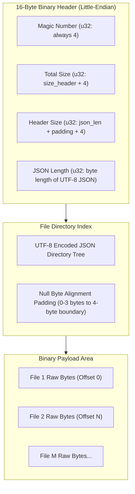

# Electron ASAR Binary Specification & Architecture Guide 📦

This document outlines the binary format specification, header layout, metadata indexing, and cryptographic integrity verification of the **Electron ASAR (Atom Shell Archive)** container as implemented in **Antigravity RTL**.

---

## 1. Executive Summary & Overview

An ASAR archive is an uncompressed, indexed archive format designed by GitHub/Electron to package web applications into a single binary file. Electron reads files directly from within the ASAR using memory-mapped I/O (`Archive::Init` in Electron C++ source), avoiding disk extraction overhead while mitigating Windows file-locking issues.

Antigravity RTL implements a **zero-dependency, high-performance pure Python parser and builder** that rigorously complies with Electron's C++ binary specifications.

---

## 2. Binary Layout Diagram



---

## 3. Header Fields Specification (16 Bytes)

The archive opens with four 32-bit unsigned integers (`<IIII` in Python `struct` notation):

| Field Index | Byte Range | Field Name | Type | Value / Description |
|:---:|:---:|:---|:---:|:---|
| **0** | `00 - 03` | `magic` | `uint32_le` | **Must always equal `4`**. Indicates the archive version / format signature. |
| **1** | `04 - 07` | `size_total` | `uint32_le` | Total byte length of the header descriptor: `size_header + 4`. |
| **2** | `08 - 11` | `size_header` | `uint32_le` | Total byte length of the JSON string + null padding + 4 bytes: `json_len + padding + 4`. |
| **3** | `12 - 15` | `json_len` | `uint32_le` | Exact byte length of the UTF-8 serialized JSON metadata tree. |

### 4-Byte Alignment Rule
Electron requires the JSON payload to end on a 4-byte boundary:
$$\text{pad\_len} = (4 - (\text{json\_len} \pmod 4)) \pmod 4$$
The archive writes $\text{pad\_len}$ null bytes (`\x00`) immediately following the JSON data before the payload begins.

---

## 4. JSON Directory Tree Schema

The metadata section is a serialized JSON object containing a recursive filesystem tree.

### 4.1. Directory Node
A directory node contains a `"files"` dictionary mapping child filenames to their respective nodes:
```json
{
  "files": {
    "dist": {
      "files": {
        "preload.js": { ... }
      }
    }
  }
}
```

### 4.2. Regular File Node
A regular file node defines its location in the payload and its integrity block:
```json
{
  "offset": "0",
  "size": 18452,
  "integrity": {
    "algorithm": "SHA256",
    "hash": "b2c8990c741e24748083818e87498c566418b76c8c7fbe8b5bfa780d6f3454b6",
    "blockSize": 4194304,
    "blocks": [
      "b2c8990c741e24748083818e87498c566418b76c8c7fbe8b5bfa780d6f3454b6"
    ]
  }
}
```

> [!NOTE]
> Notice that `"offset"` is serialized as a string (e.g. `"0"`, `"18452"`) to prevent integer overflow in 32-bit JavaScript runtime environments when archives exceed 2 GB.

### 4.3. Unpacked Node
Files excluded from the archive (e.g. native C++ `.node` binaries) reside on disk in `app.asar.unpacked`:
```json
{
  "unpacked": true,
  "size": 1048576
}
```
Antigravity RTL automatically skips unpacked files during repackaging, preserving their filesystem pointers intact.

---

## 5. Cryptographic Integrity Blocks (SHA-256)

Modern Electron releases verify file authenticity using SHA-256 block hashing:
1. The binary data for each file is partitioned into chunks of `blockSize` (default: **4,194,304 bytes / 4 MB**).
2. For each chunk, a SHA-256 hexadecimal digest is computed and appended to the `"blocks"` array.
3. The overall `"hash"` contains the SHA-256 digest of the entire file.

Antigravity RTL implements `sha256_blocks()` in `src/antigravity_rtl/core/asar.py` to calculate these blocks dynamically upon injection, guaranteeing full compatibility with Electron runtime security validations.

---

## 6. Packaging & Inspection Algorithms in Python

### Reading a File:
```python
# 1. Unpack header
hdr = f.read(16)
magic, size_total, size_header, json_len = struct.unpack("<IIII", hdr)
payload_start = 16 + (size_header - 4)

# 2. Parse JSON
json_bytes = f.read(json_len)
header = json.loads(json_bytes.decode("utf-8"))

# 3. Read slice
offset = int(file_node["offset"])
size = int(file_node["size"])
f.seek(payload_start + offset)
file_data = f.read(size)
```

### Rebuilding & Replacing:
1. Traverse tree and record original file entries.
2. Replace targeted content (e.g. `dist/preload.js`).
3. Recompute consecutive offsets (`current_offset += len(content)`).
4. Recompute `sha256_blocks` for modified contents.
5. Serialize JSON, calculate padding, prepend the 16-byte header prefix, and stream payload.

---

## 7. Cross-Platform Safe Replacement

On Windows, `app.asar` may be locked if Antigravity is active. Antigravity RTL handles this via:
1. **Graceful Close:** Initiating `taskkill /IM Antigravity.exe` (sending `WM_CLOSE`).
2. **Atomic Swap:** Rebuilding into a temporary file `app.asar.patching.tmp`, then executing an atomic `shutil.move()`.
3. **In-place Truncate Fallback:** If filesystem locks prevent atomic rename, open in `r+b` mode, seek to `0`, write, and `truncate()`.
